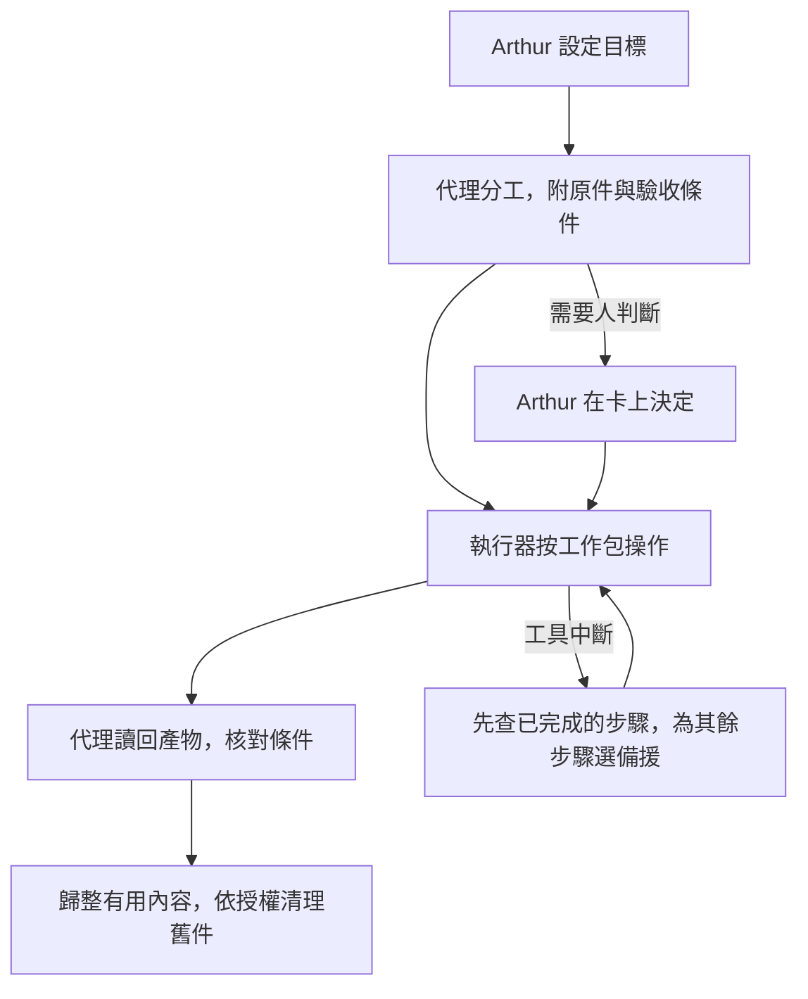

# BH｜讓代理跨對話接手工作

BH 是 Arthur 設計、維運的多代理協作系統。截至 2026/11/23 登記 28 席，交接信跨三個節點同步，工作紀錄可回溯至 10/20。換了對話，誰做過什麼、憑據在哪、人的決定如何接續？

Arthur designed BH so AI agents can hand off work when a chat ends. Logs span October 20 to November 23, 2026. At that point, BH had 28 registered roles, and three nodes shared its handoff files. Arthur sets the rules for what each role can do and how it must show its work. Agents run tasks and check the results. If a choice needs human judgment, a card records both the question and Arthur’s answer for the next agent to read.

## 設計與分工

Arthur 設計四層規則（Harness）並保留版本，要求交接信（Thread）以雜湊指回原件、人的決定寫回卡片，同一教訓再現就升為規則或檢查。代理實作、測試，用 panel 核對產物。

GPT、Claude 擔任代理，Syncthing 同步檔案，PostgreSQL 保存工作記憶。

## 實例

**實驗完成，工具上線了嗎？** 代理用原識別碼核對語音實驗結果，無須重跑。工具修補通過 9 項單元測試，部署仍待驗證。

**信件讀不到，檔案壞了嗎？** 另一端能開同一檔，團隊查出快取異常。修復後 42 份檔案全可讀。第二次發生後，「先跨端讀同一原件」成為全域規則。

## 量測與限制

| 盤點 | 觀察 |
|---|---|
| 11 月 17 日，歷史封包搬移 | 在目的地逐份比對大小、雜湊與壓縮檔完整性，380/380 份通過。 |
| 11 月 18 日，交接信收存 | 83 封可識別來信中，43 封有完整收存回條，盤點找出其餘 40 封的證據缺口。 |

回條記錄信件去向。驗證代理自述的成果，仍須查驗產物。

## 名詞表

| 名詞 | 在 BH 裡的作用 |
|---|---|
| 席位 | 可交接的長期職責，各有負責事項與收件匣。 |
| Harness | 選定一版規則，依全域、席位類型、集群及個別席位套用。 |
| Thread | 帶有識別碼與內容雜湊的交接信，回覆可追溯到原件。 |
| panel | 每輪開工時列待辦、收工時對照產物與回條的檢查面板。 |

## 從問題找到子系統

| 你想知道什麼？ | 子系統 |
|---|---|
| 如何沿著交接信找回原文和收存回條？ | [Thread](./thread/README.md) |
| 下一手如何知道一件工作由誰負責、卡在哪裡？ | [工作項追蹤](./work-items/README.md) |
| 不同角色接手時，依據的是哪一版規則？ | [Harness](./harness/README.md) |
| 工作開始前，要把哪些驗收條件寫進工作包？ | [Loom](./loom/README.md) |
| 工作包交出去後，怎麼知道哪些步驟做完了？ | [Weaver](./weaver/README.md) |
| 實驗結束後，如何把結果對回原紀錄？ | [EP（ExperimentPipeline）](./ep/README.md) |
| 送出喚起訊號後，怎麼判斷有沒有人接到？ | [WAG](./wag/README.md) |
| 系統有哪些工具，如何查它們彼此的關係？ | [Nerve](./nerve/README.md) |
| 工具請求從哪裡進入執行環境？ | [bh-engine](./bh-engine/README.md) |
| 人從哪裡看工作進度、回覆待決事項？ | [Workbench](./workbench/README.md) |
| 怎麼看出有哪些證據還沒補齊？ | [Panel](./panel/README.md) |
| 需要人的決定時，下一手如何看見並接續？ | [看板與卡片](./board-cards/README.md) |
| 整理舊資料後，如何確認原件仍可查？ | [代謝](./metabolism/README.md) |
