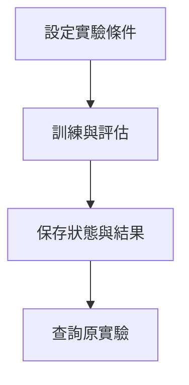

重新編寫的示範，不是產品原碼

# EP｜讓研究實驗的結果可以回查

EP（ExperimentPipeline）是與 BH 協作的研究子系統。它把模型訓練與評估排成實驗，記下實驗條件、執行狀態與結果。研究者事後可以找到同一場實驗，查它採用了哪些條件，以及留下了什麼結果。



## 在 BH 裡跟誰接

研究者可從 Workbench 查閱實驗狀態。當 EP 的查詢工具需要修改時，Weaver 可以承接變更，並交回測試結果供審查。

## 數字與限制

2026 年 11 月 15 日，一次與既有實驗結果有關的命令列工具修正通過 **9/9 項隔離測試**。分母是該次回件列出的全部隔離測試。核對時，先讀測試結果，再用版本識別值確認審查回件指向同一份修改。這項紀錄只涵蓋該組測試。完整測試、部署狀態與模型效能各需其他證據。

## 示範輸入 → 輸出

這個離線例子只比較兩組實驗結果，假設誤差越小越好。在甲、乙、丙三個虛構項目上，基準輸入依序為 8、6、4，候選輸入為 6、5、4。執行同目錄的 `python3 demo.py`，得到下列輸出。

```text
基準平均誤差 6
候選平均誤差 5
候選減基準 -1
```

差值為負表示這組輸入的平均誤差下降。例子只比較這組固定數值，未估計統計顯著性。

[查看離線示範](./demo.py)

[回子系統索引](../README.md) · [Weaver](../weaver/README.md) · [Workbench](../workbench/README.md)
