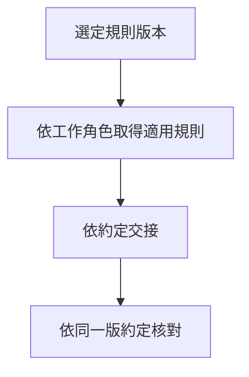

# Harness｜交接時，雙方依哪一版規則？

即使工作名稱相同，規則也可能改過。Harness 保存規則版本，再從全域、席位類型、集群到個別席位，選出這次工作適用的內容。接手者因而能重查當時的約定。

### 如何與其他部位交接

Thread 對照當版的交接信約定，Loom 對照工作包約定；Panel 在開工與收尾時使用適用規則。版本紀錄說明規則寫了什麼。要查某個執行端當時有沒有採用，還需要它自己的讀回紀錄。

### 量測與限制

在一次選版快照中，先鎖定所選版本，再只計算契約目錄直屬的一般檔案，共 21 份。這個數字是該版的契約檔存量，會隨版本改變。它沒有量到規則被遵守的比率。

[回子系統索引](../README.md) · [Loom](../loom/README.md) · [Thread](../thread/README.md)
