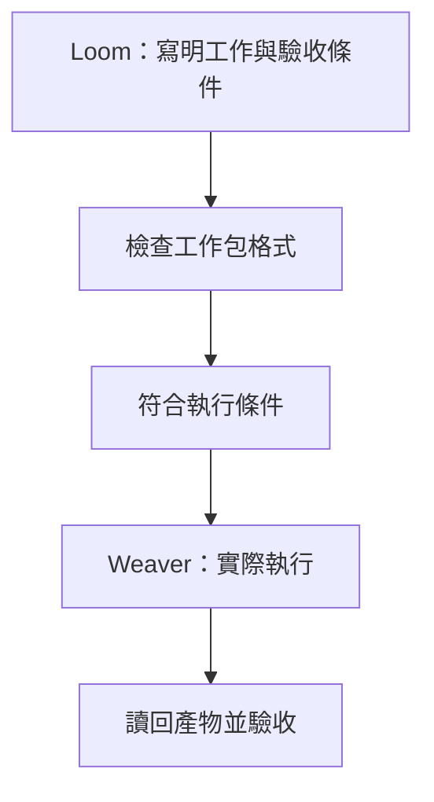

# Loom｜工作交出去之前，怎麼約定驗收？

Loom 定義工作包要說清楚的事：預期產物是什麼、要做哪些工作，以及完成後用什麼證據核對。執行前可先檢查工作包格式；需要人決定的工作可以停在審閱階段。

### 如何與其他部位交接

Thread 可傳遞一項工作請求。Loom 約定可執行工作包的內容；Weaver 接手後才實際執行、記錄結果。讀工作包可以知道「預計做什麼」，核對執行回件和產物才能知道「實際做到什麼」。

### 量測與限制

在一次選定版本中，取出工作包格式契約列明的檢查規則，依規則識別碼去重後共有 8 條。這是該版規格的規則數。缺少同版本受測工作包及錯誤件數的分母，無法據此計算攔錯率或執行成功率。

[回子系統索引](../README.md) · [Weaver](../weaver/README.md) · [Thread](../thread/README.md)
