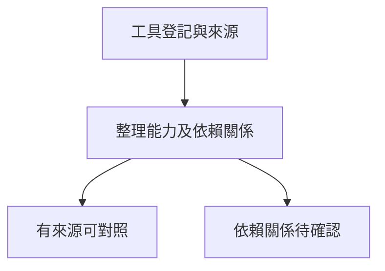

重新編寫的示範，不是產品原碼

# Nerve｜工具能力的來歷可以追到哪裡？

Nerve 是能力登記與依賴關係的目錄。它記下某項能力從哪份來源整理而來、與哪些其他能力有關；來源無法確認的關係可以保留為待查，讓接手者知道還要核對什麼。



### 如何與其他部位交接

bh-engine 的工具登記可供 Nerve 整理。查 Nerve 可以回答「這項能力依據什麼列入」；查執行端的工具回條，才能回答「它這次實際做了什麼」。

### 量測與限制

一次來源核查選取 23 筆，逐筆比較登記所指的來源版本與工作副本。22 筆內容相符，另 1 筆記有本地修正。分母只涵蓋當次選取的來源；這項核查沒有測試工具的成功率、速度或全部依賴是否齊備。

## 示範輸入 → 輸出

輸入一張海報的前置表，另外給一組互相等待的虛構元件「甲、乙」。在本資料夾用 Python 3 執行 `python3 -I -B demo.py`，輸出如下：

```text
[["底稿"], ["圖形", "文字"], ["樣張"]]
相依成環
```

第一行每個內層陣列是一層可開始製作的元件。第二行表示甲、乙互相等待，無法排出順序。範例只使用程式內的虛構名稱，沒有外部資料或連線。

[查看離線示範](./demo.py)

[回子系統索引](../README.md) · [bh-engine](../bh-engine/README.md)
