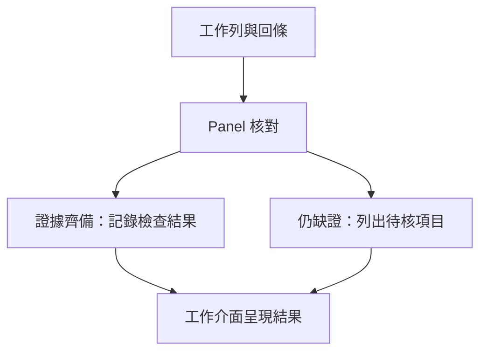

# Panel｜交件前，還有哪些事情缺證據？

Panel 在開工時列出待處理工作，在收尾時把回報與工作紀錄對照。當一項要求仍缺證，審閱者能看到要追哪一項，而不用從整段工作對話猜測。

### 如何與其他部位交接

工作項追蹤提供工作列與驗收要求，Thread 提供交接回條；Workbench 可以呈現 Panel 的判讀。若要知道某項產品是否真的達標，仍可從檢查結果追到對應產物。

### 量測與限制

一次收尾日誌列出 12 筆待驗項目。量法是計數該次檢查的待驗清單，再核對同一份日誌末段的放行判定：該輪未放行。同一問題可能影響多個項目，因此 12 筆不能換算成 12 個獨立故障，也不能用來估算其他輪次的通過率。

[回子系統索引](../README.md) · [工作項追蹤](../work-items/README.md) · [Workbench](../workbench/README.md)
