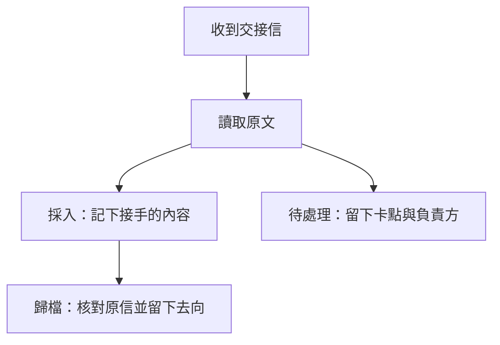

重新編寫的示範，不是產品原碼

# Thread｜一封交接信到了哪裡？

Thread 把交辦原文、所附資料與內容清單放進同一封信。接手的人可以用訊息編號找到原信，再用內容雜湊確認自己拿到的是同一版。



### 如何與其他部位交接

WAG 可以提醒收件方查信。**讀取**留下看過哪份正文的憑據；**採入**記錄收件方接下哪些內容；**歸檔**留下原信的識別、雜湊與存放去向。Panel 可據此追問哪一環仍缺證，代謝則能沿著歸檔紀錄找回原件。若信中要求製作產品，產品還要有自己的驗收結果。

### 量測與限制

一次盤點列出 89 筆紀錄，扣除 6 筆無有效訊息編號的分類紀錄，得到 83 封可識別來信。逐封核對來源雜湊、讀取／採入／歸檔回條、完整性及去向，43 封有完整憑據，40 封當時缺少其中至少一項。這組數字描述該次盤點能查到的回條；無法藉此判定信中工作是否完成。

## 示範輸入 → 輸出

甲的正文是「初稿」，有兩張相同的當版回條。乙的正文是「二稿」，回條對應「一稿」。丙的正文是「結語」，沒有回條。執行同目錄的 `python3 demo.py`，得到下列輸出。

```text
甲 → 相符
乙 → 版本不符
丙 → 缺回條
```

[查看離線示範](./demo.py)

[回子系統索引](../README.md) · [WAG](../wag/README.md) · [Panel](../panel/README.md) · [代謝](../metabolism/README.md)
