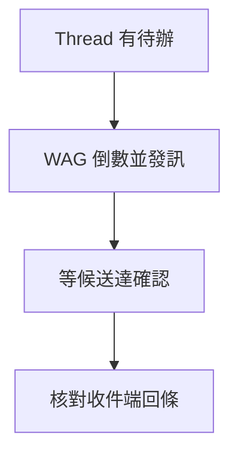

# WAG｜通知處理端有工作待接

Thread 中有工作等候處理時，WAG 可在倒數後發出喚醒訊號，並記錄觀察到的反應。若要判定某件工作是否送達，需要把收件端的回條對回那件工作。

## 在 BH 裡跟誰接

Thread 保存待辦與收件回條。WAG 記錄發訊的時間和觀察結果。查詢工作是否實際執行，還需要處理端交回該件工作的產物或執行紀錄。

## 數字與限制

2026 年 11 月 15 日的一次喚醒，從開始倒數到發訊經過 **46 秒**。發訊後 **20 秒**的檢查仍記為「送達未確認」。兩段時間取自同一事件，分別將倒數、發訊與送達檢查的相鄰時間戳相減。這次紀錄只涵蓋一個樣本，無法據以推估通常要等多久，也無法證明這件工作已被接手或執行。

[回子系統索引](../README.md) · [Thread](../thread/README.md)
