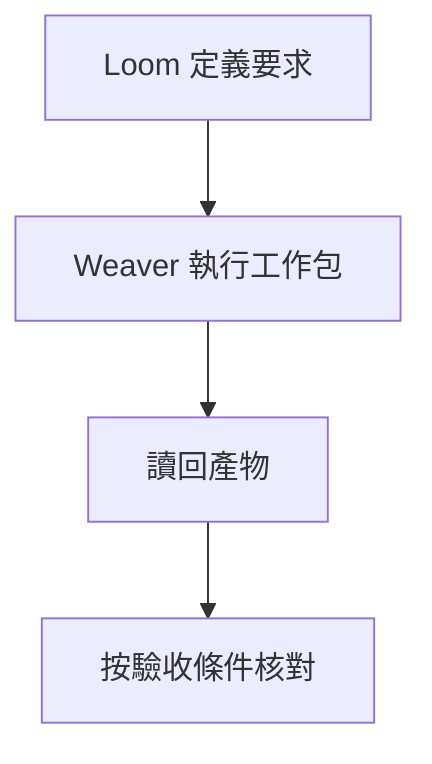

# Weaver｜執行工作包並核對產物

Weaver 接手已定義的工作包，按步驟執行並留下產物。驗收時，審查者可把工作包要求的結果逐項對到實際讀回的內容，包括哪些資料應該改、哪些應該保留。

## 在 BH 裡跟誰接

Loom 提供工作內容與驗收條件。Weaver 依條件交回產物和證據，Workbench 則提供唯讀畫面，供人查閱執行狀態。

## 數字與限制

2026 年 11 月 19 日，一個文件更新工作包要求更新的 **4 份中有 4 份**符合要求，指定保留的 **7 份中有 7 份**維持原樣。兩組分母都取自該工作包的預定條件。核對時，比對預定值與觀察值，再核驗所引的應用端與原始資料讀回紀錄。兩組數字描述同一個工作包，適用範圍限於該次驗收。

[回子系統索引](../README.md) · [Loom](../loom/README.md) · [Workbench](../workbench/README.md)
