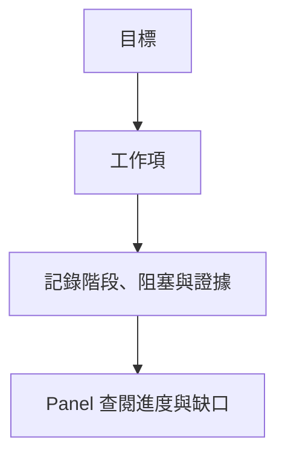

重新編寫的示範，不是產品原碼

# 工作項追蹤｜追蹤工作項與待補證據

工作項追蹤把目標拆成可以交接的工作項。每列記錄責任歸屬、所處階段、卡住的原因及驗收證據，讓下一手能看出還要補什麼才能繼續。



## 在 BH 裡跟誰接

Panel 讀取工作項，檢視證據是否足以放行。需要人裁決的事項可由看板呈現。更新工作列只記錄進度，放行須另查相應的裁定。

## 數字與限制

2026 年 11 月 18 日，一次歷史對帳記錄修正了 **3 列**。量法是核對同一份回件的狀態與變更說明，計數範圍是這一批被修正的工作列。修正限於階段與證據位置，回件仍記有阻塞。原件只提供批次摘要，未附逐列前後快照，也無法據此計算完成率。

## 示範輸入 → 輸出

使用「整理」完成後可核算、校字，兩者完成後才能交稿的虛構工作表，依序加入「已完成」項目。執行同目錄的 `python3 demo.py`，每行箭頭右側列出當下可接手的工作。

```text
起點 → 整理
完成整理 → 核算、校字
再完成核算 → 校字
再完成校字 → 交稿
```

核算完成時，交稿仍在等校字。校字也完成後，交稿才出現在清單。

[查看離線示範](./demo.py)

[回子系統索引](../README.md) · [Panel](../panel/README.md) · [看板與卡片](../board-cards/README.md)
